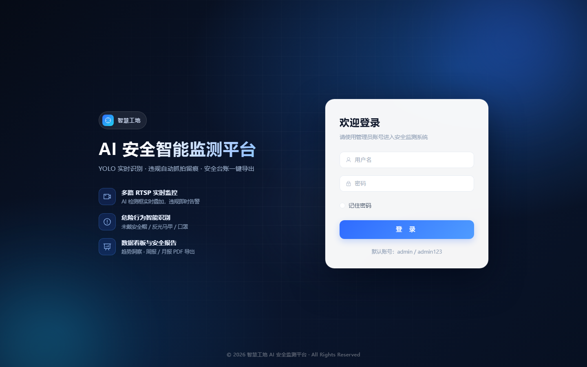
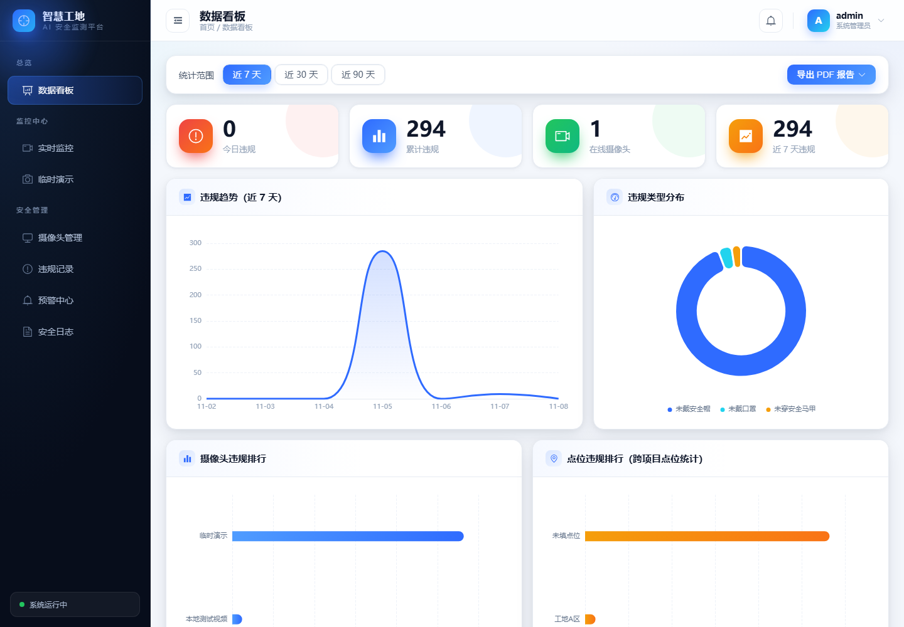
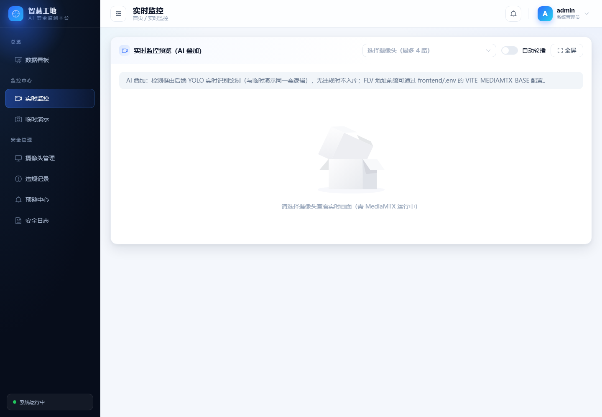
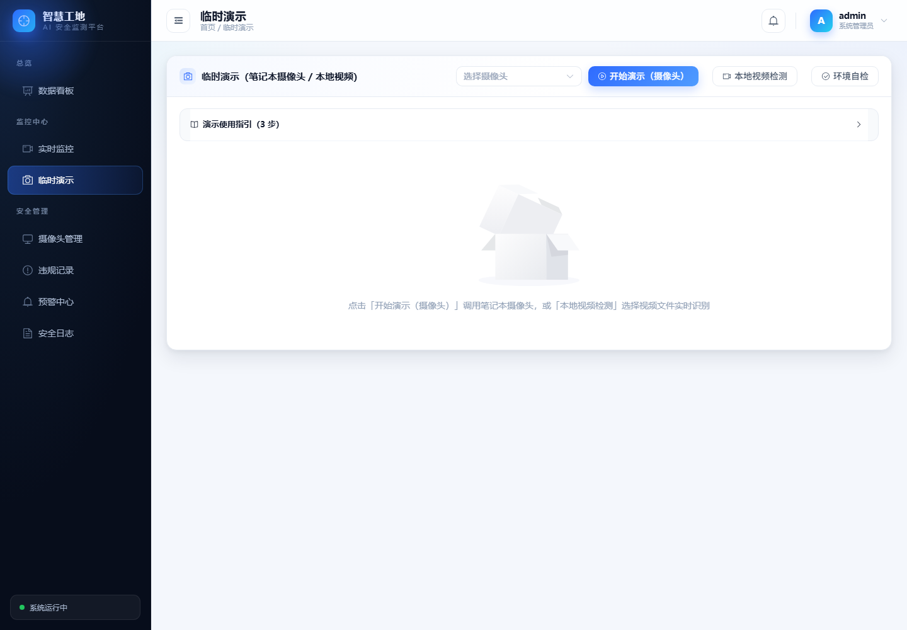
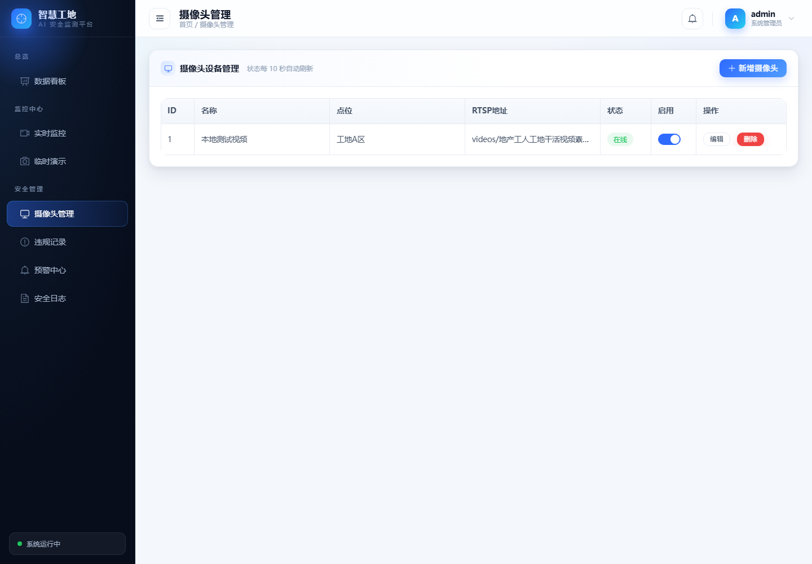
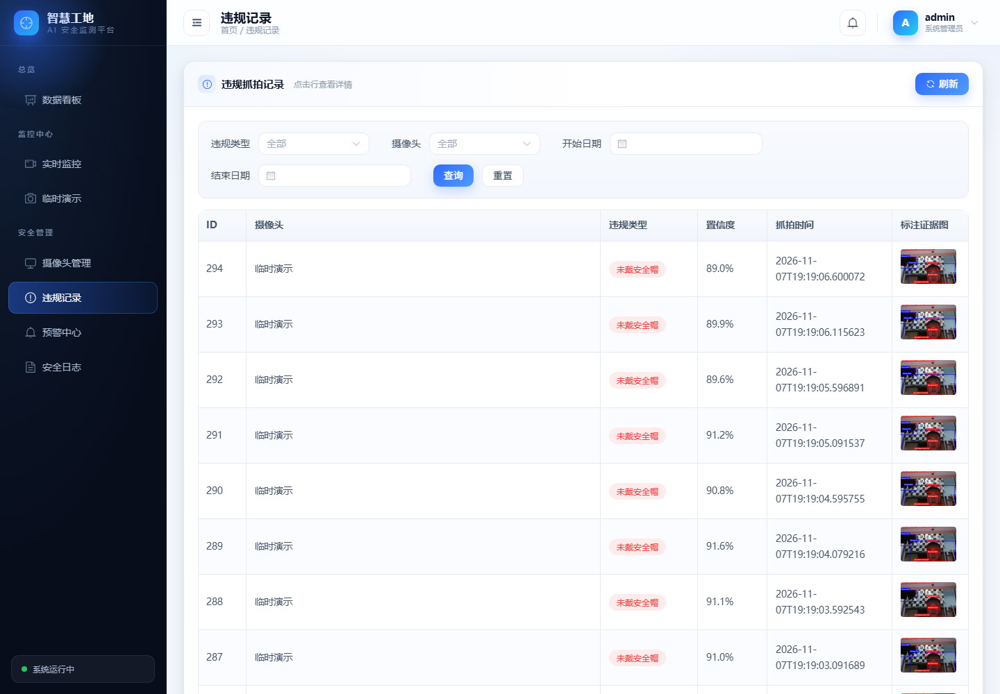
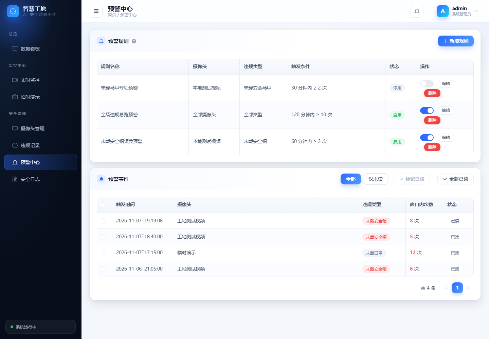
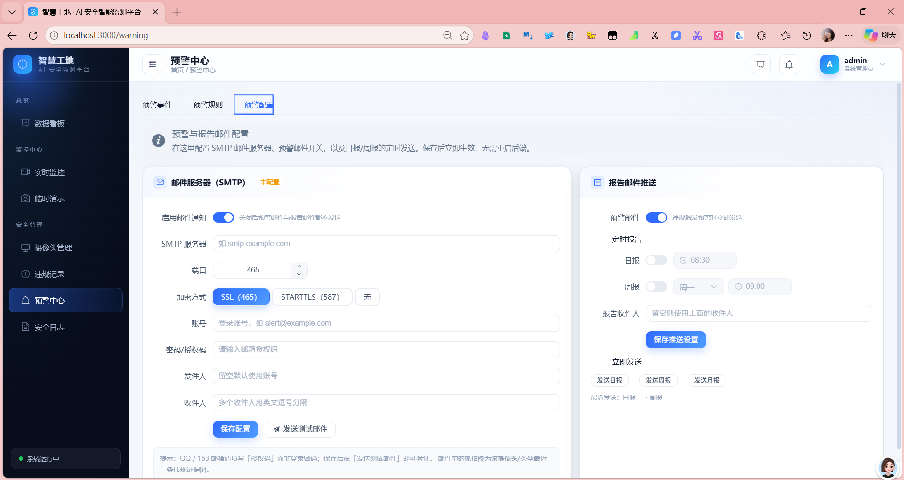
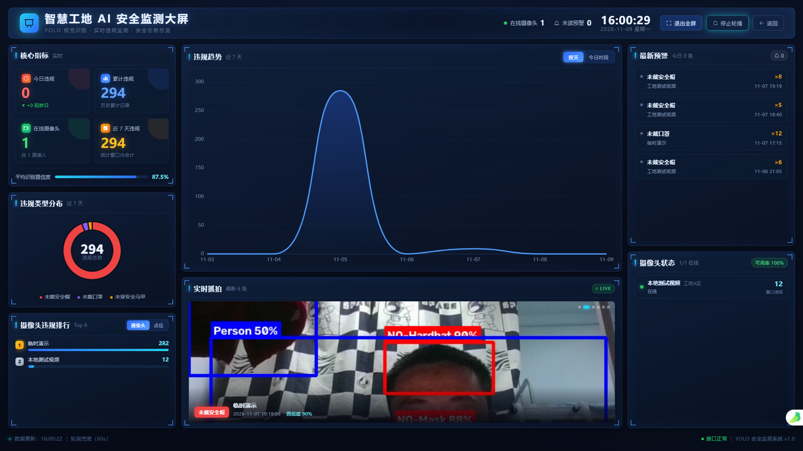
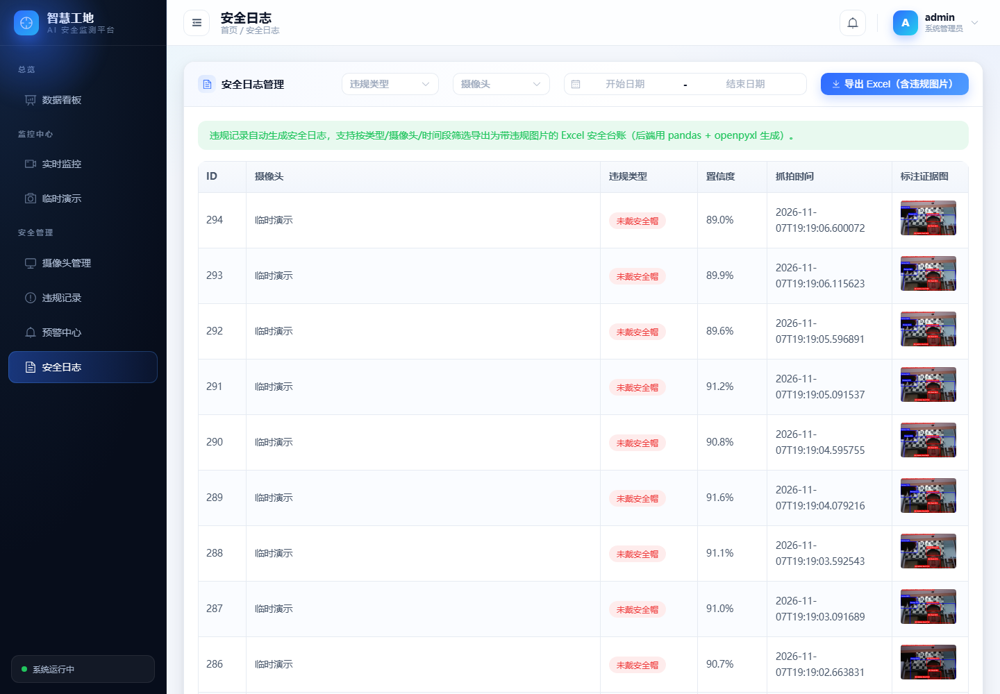

# 工地 AI 安全智能监测系统（YOLO 版）

## What This Does

基于 **YOLOv8** 的工地安全智能监测后台：自动对接主流监控摄像头（海康 / 大华等，RTSP 协议），实时识别未戴安全帽 / 未穿马甲 / 未戴口罩等违规行为，**违规瞬间自动抓拍**（原始帧 + 标注证据图）入库，并提供 **Vue3 可视化后台**（数据看板 / 实时监控 / 违规记录 / 预警中心 / 日志导出）。仓库同时保留原始视频文件 PPE 检测脚本。

一句话：**让 AI 盯着工地，替安全员抓拍每一个不规范穿戴瞬间，把违规留痕变成可管理的数据。**

> ⚠️ **适配说明（本仓库已适配 `ppe.pt` 模型）**
>
> - 类别顺序（10 类）：`0 Hardhat, 1 Mask, 2 NO-Hardhat, 3 NO-Mask, 4 NO-Safety Vest, 5 Person, 6 Safety Cone, 7 Safety Vest, 8 machinery, 9 vehicle`
> - 违规判定为 **direct 模式**：模型直接输出违规类（`NO-*`），出现即判违规，无需 IoU
> - `inference/` 与 `backend/app/detection/` 均支持 `person_iou` 通用模式（正类装备模型）
> - 后端演示模式会自动搜索模型路径（Docker 与本地均可用）
> - 本地默认 **SQLite**（零依赖可跑），Docker 部署时由环境变量覆盖为 MySQL

### 核心能力速览

- **监控设备对接**：RTSP 拉流 + MediaMTX 转发，后台实时预览（多路同屏 2×2 + 自动轮播 + **AI 检测框叠加**）
- **AI 智能识别**：YOLOv8 识别未戴安全帽 / 未穿马甲 / 未戴口罩
- **自动抓拍留痕**：违规瞬间保存 **原始帧 + 标注证据图**（检测框 + 中文违规横幅）双份入库
- **安全日志管理**：违规时间 / 点位 / 类型 / 置信度日志，类型/摄像头/日期筛选 + **Excel 导出（内嵌违规图片缩略图）**
- **PDF 安全报告**：一键导出 **周报 / 月报**（reportlab：统计摘要 + 违规趋势图 + 类型分布 + 点位排行 + 违规明细，中文无需系统字体）；支持**导出后直接邮件发送**
- **预警中心**：自定义预警规则（摄像头 / 违规类型 / 次数阈值 / 时间窗口），违规频发自动触发事件，顶栏铃铛实时提醒（SSE 秒级推送）
- **邮件告警（网页配置）**：预警中心「预警配置」页签在线配置 SMTP、预警邮件开关、日报/周报定时推送与收件人；预警邮件正文 + 抓拍图附件；报告导出可直接邮件发送
- **智慧大屏**：独立深色全屏大屏（多屏布局 / 值班轮播 / 告警插播+声音 / Kiosk 全屏），适配 2K/4K 与电视墙
- **Web 后台管理**：数据看板（7/30/90 天趋势切换、类型分布、摄像头排行、点位排行，**实时推送刷新** + 新增违规提醒）、摄像头管理（**RTSP 连通性测试**）、违规记录（详情抽屉：原图/标注图切换 + 帧内检测明细）
- **临时演示模式**：直接调用笔记本摄像头实时识别 + 违规抓拍，无需接监控设备，适合现场演示（灵敏度调节 / 只看违规 / 画质 / 镜像 / 全屏 / 演示统计 / 抓拍时间线 / 环境自检）
- **视频文件检测脚本**：对本地视频文件做 PPE 检测并导出标注视频（CPU / GPU）

## 功能介绍与界面预览

> 以下截图均取自系统真实运行环境（深空科技蓝主题，Vue3 + Element Plus + ECharts 重新设计的视觉体系）。后台默认账号 `admin / admin123`。

### 1. 登录认证

JWT 登录鉴权，登录态失效自动跳转登录页；记住密码、玻璃拟态渐变登录界面。



### 2. 数据看板

聚合展示今日 / 累计违规、在线摄像头、近 N 天违规量；支持 7/30/90 天趋势切换，含违规趋势折线、违规类型分布环形图、摄像头违规排行与点位违规排行；**新违规通过 SSE 实时刷新**（增长即弹窗提醒，60s 轮询兜底），也可一键下载周报 / 月报 PDF 或**直接邮件发送报告**。



### 3. 实时监控（AI 检测框叠加）

选择最多 4 路摄像头同屏预览（2×2，支持自动轮播 / 全屏），画面经后端 YOLO 实时识别并叠加检测框（红=违规、绿=合规、蓝=其他目标），无违规不入库。



### 4. 临时演示

无需接入监控设备，直接调用笔记本摄像头或本地视频文件做实时识别；可调灵敏度、只看违规、镜像、画质、全屏，带模型加载提示、延迟 / 帧率、演示统计与抓拍时间线，现场演示零门槛。



### 5. 摄像头管理

维护摄像头名称、安装点位、RTSP 地址，支持 **RTSP 连通性测试**（8 秒兜底）与在线状态自动刷新；启用后推理服务自动接入该路拉流。



### 6. 违规记录

按类型 / 摄像头 / 日期筛选违规记录，列表内嵌**标注证据图**缩略图；点击任意行打开详情抽屉，可在原图与标注图间切换，并查看该帧全部检测目标（类别 / 置信度 / 区域坐标）。



### 7. 预警中心

自定义预警规则（摄像头 / 违规类型 / 时间窗口 / 次数阈值，留空 = 全部），违规频发自动生成预警事件并在顶栏铃铛**实时提醒（SSE，10 分钟冷却防刷屏）**；支持未读筛选与批量标记已读。**「预警配置」页签**可在线设置邮件 SMTP、预警邮件开关、日报/周报定时推送与收件人。



### 8. 邮件告警与报告推送（网页配置）

在「预警中心 → 预警配置」：

- **SMTP 服务器**：服务器 / 端口 / 加密方式（SSL 465、STARTTLS 587）/ 账号 / 授权码 / 发件人 / 收件人，支持「发送测试邮件」验证；
- **报告推送**：预警邮件开关、日报（时间）、周报（星期几 + 时间）、报告收件人，支持「立即发送报表」；
- 保存即生效（写入 `system_settings` 表，优先级高于 `.env`）；预警邮件正文含抓拍图附件；每日/每周报告由后端定时任务自动发送。



### 9. 智慧大屏

独立全屏深色大屏（`/screen`，1920×1080 等比缩放，适配 2K/4K/拼接屏）：核心指标、类型分布、违规排行、趋势主图（按天/今日时段）、实时抓拍轮播、最新预警、摄像头在线状态。



**启动方式（三选一，均为网页内直接进入，无需先跑脚本）：**

1. 数据看板右上角「进入智慧大屏」下拉 → 选「全屏值班 / 电视墙」即跳转大屏并进入全屏+轮播；也可选总览布局 / 告警布局 / 轮播值班；
2. 大屏右上角按钮：**全屏**、**值班轮播**（一键启停总览 ↔ 告警切换）、返回；
3. 需要开机自启/无边框 Kiosk 时，用 `deploy/start-screen.bat`（Chrome/Edge Kiosk 全屏，自动允许告警声音）。

支持 URL 参数：`?layout=overview|alerts`、`?rotate=秒`（值班轮播）、`?present=1`（展厅模式，隐藏操作按钮）与告警插播+提示音。

### 10. 安全日志与导出

违规记录自动沉淀为安全台账，支持按类型 / 摄像头 / 时间段筛选，**一键导出内嵌违规图片缩略图的中文 Excel**；详情抽屉可追溯每条违规的原始帧与 AI 标注证据。



## Quick Start（5 分钟跑起来）

两种方式任选其一：**本地开发**（默认 SQLite，零 MySQL，最贴近日常开发）或 **Docker 部署**。

### 方式一：本地开发（推荐）

**前置条件：** Python 3.12 + [uv](https://docs.astral.sh/uv/)、Node.js 18+、模型权重 `ppe.pt`（克隆后若缺失，从根目录复制一份到 `inference/weights/`）。

**三个终端分别启动后端 / 推理服务 / 前端：**

```bash
# ① 后端（SQLite，自动建表，端口 8000）
cd backend
uv sync
uv run uvicorn app.main:app --reload

# ② 推理服务（RTSP 拉流 + 检测 + 上报）
# 注意：必须从仓库根目录启动（inference 是包名，不是顶层目录）
cd ..
CONFIG_PATH=inference/config.local.yaml uv run python -m inference.main

# ③ 前端（端口 3000，已代理 /api 与 /images 到 localhost:8000）
cd frontend
npm install
npm run dev
```

> 也可以双击根目录 `start-local.bat` 一键启动（后端 + 前端；推理服务默认注释掉，需先录入摄像头再取消注释）。或执行 `python start-local.py`（Python 版，带健康检查与 `--inference` 可选推理服务、`--open screen` 自动打开大屏）。

### 方式二：Docker 部署

```bash
# 1. 确认模型权重存在（从根目录复制，若缺失）
ls inference/weights/ppe.pt

# 2. 一键启动全部服务
docker compose up -d --build
```

**Docker 环境由 `docker-compose.yml` 覆盖配置：** `DATABASE_URL` 指向 MySQL、`UPLOAD_DIR=/data/images`。

### Verify It's Working

| 检查项 | 方法                                               | 预期结果                                |
| ------ | -------------------------------------------------- | --------------------------------------- |
| 后端   | 打开`http://localhost:8000/docs`                 | Swagger 接口文档可访问                  |
| 前端   | 打开`http://localhost:3000`                      | 登录页，用`admin / admin123` 登录     |
| 演示   | 前端 →「临时演示」→ 授权摄像头 → 开始演示       | 画面实时叠加检测框，违规标红 + 抓拍入库 |
| 图片   | 违规后访问`http://localhost:8000/images/xxx.jpg` | 能看到原始帧 / 标注证据图               |

## Project Structure

```
yolo-safety-system/
├── backend/                 # FastAPI 后端（SQLite/MySQL，演示模式推理）
│   ├── app/
│   │   ├── main.py          # 应用入口：建表、schema 演进、模型预热、路由注册
│   │   ├── config.py        # pydantic-settings 配置（SQLite 默认 / MySQL 可覆盖）
│   │   ├── models.py        # ORM 五张表（Camera / Violation / WarningRule / WarningEvent / SystemSetting）
│   │   ├── schemas.py       # Pydantic 请求/响应模型
│   │   ├── security.py      # JWT 认证
│   │   ├── database.py      # 引擎与 Session（SQLite check_same_thread / MySQL 连接池）
│   │   ├── detection/       # 演示模式检测模块（与 inference/ 双份同步）
│   │   ├── routers/         # auth / cameras / violations / logs / demo / warnings / realtime / settings
│   │   └── services/        # warnings（预警触发）/ events（SSE 总线）/ mailer（邮件）/ settings_service（配置）/ report_scheduler（日报周报定时）
│   ├── pyproject.toml / requirements.txt
│   ├── init.sql             # 建库建表（生产用）
│   └── Dockerfile
├── inference/               # YOLO 推理服务（每摄像头一个 StreamWorker 线程）
│   ├── detector.py          # YOLO 封装（predict 支持 conf 覆盖）
│   ├── judge.py             # 违规判定（direct / person_iou）
│   ├── annotate.py          # 标注证据图（检测框 + 中文横幅）
│   ├── stream_worker.py     # RTSP 拉流 + 抓拍 + multipart 上报
│   ├── main.py              # 多摄像头并发入口（从后端拉取启用列表）
│   ├── config.yaml          # Docker 配置
│   ├── config.local.yaml    # 本地开发配置
│   ├── weights/             # 模型权重（ppe.pt，*.pt 不入库）
│   └── Dockerfile
├── frontend/                # Vue3 前端（Vue3 + TS + Element Plus + Vite + ECharts + flv.js）
│   ├── src/
│   │   ├── api/             # 接口封装（auth / camera / violation / log / demo / warning / settings）
│   │   ├── views/           # Login / Dashboard / monitor / demo / camera / violation / warning(+MailReportConfig) / log / screen
│   │   ├── components/screen/  # 大屏面板组件（KpiPanel / TrendPanel / LiveFeed / Alert / CameraStatus 等）
│   │   ├── composables/     # useRealtime（SSE）/ usePolling / useScreenScale
│   │   ├── layout/          # MainLayout（侧边菜单 + 预警铃铛）
│   │   ├── constants/       # violations.ts（共享常量）/ screenTheme.ts（大屏配色）
│   │   ├── styles/          # 设计系统（颜色/间距/圆角/阴影 token + Element Plus 皮肤覆写）
│   │   ├── utils/           # request.ts（token 拦截器）/ draw.ts（canvas 叠加）/ download.ts / echarts.ts
│   │   └── router/          # 路由懒加载 + 登录守卫（含独立 /screen 路由）
│   ├── public/demo-login.html  # 演示自动登录落地页（start-demo.py 使用）
│   ├── Dockerfile / nginx.conf
│   └── .env / .env.example  # VITE_MEDIAMTX_BASE
├── deploy/
│   ├── mediamtx.yml         # 流媒体配置（RTSP 入 8554、HTTP 出 8080）
│   └── start-screen.bat     # 大屏 Kiosk 全屏启动（Chrome/Edge）
├── Safety-Detection.py             # 原始脚本：实时窗口检测
├── Safety-Detection-export.py      # 原始脚本：视频导出（CPU）
├── Safety-Detection-export-gpu.py  # 原始脚本：视频导出（GPU）
├── doc/                     # 文档系列（博客教学 + 架构参考 + API 参考）
│   └── images/screenshots/  # README 界面截图（登录/看板/监控/演示/摄像头/违规/预警/日志）
├── docker-compose.yml
├── start-local.bat          # 本地一键启动（后端 + 前端）
├── start-local.py           # 本地一键启动（Python 版，健康检查 + 可选推理服务）
├── start-demo.py            # 前端演示启动（自动登录并打开指定页面）
└── ppe.pt                   # 模型权重（根目录副本）
```

### Key Directories Explained

**`backend/app/detection/`** — 演示模式的检测/判定/标注模块，与 `inference/` 同名文件**逐行一致**（双份同步纪律，见下方核心概念）。后端因独立加载模型而复制了同一套逻辑，修改一处必须同步另一处。

**`frontend/src/constants/violations.ts`** — 违规类型中文名与检测框配色的**唯一来源**。前端 6+ 个页面共用，页面内禁止重复定义；换模型时与后端 `annotate.py` 同步修改。

**`deploy/mediamtx.yml`** — MediaMTX 流媒体服务配置：接收摄像头 RTSP 流（8554），转发为 FLV（8080）供浏览器播放，稳定拉流供推理服务使用。

## Key Concepts

### 1. 违规判定：direct 模式（ppe.pt）

ppe.pt 是"违规类模型"——直接输出 `NO-*` 违规类（`NO-Hardhat` / `NO-Mask` / `NO-Safety Vest`）。判定规则一行搞定：

```python
rule = {"no_helmet": "NO-Hardhat", "no_vest": "NO-Safety Vest", "no_mask": "NO-Mask"}
# 模型输出里出现 NO-Hardhat → 判 no_helmet 违规
```

**Why this matters:** `judge.py` 同时支持 `person_iou` 模式（正类装备模型：person + helmet，用 IoU 判断装备缺失）。换模型时要在 `inference/config.yaml` 和 `backend/app/config.py` 同时改 `judge_mode` 与 `violation_rule`。

### 2. 双份同步纪律（最容易踩的坑）

`inference/detector.py`、`judge.py`、`annotate.py` 与 `backend/app/detection/` 同名文件**逐行一致**。后端演示模式复用同一套逻辑（因独立加载模型而复制）。**改任意一处必须同步另一处**，否则正式链路与演示链路的识别/标注结果不一致。

### 3. 三条业务链路

```
① 正式链路：RTSP 摄像头 → MediaMTX → 推理服务(每摄像头一线程) → 检测/判定/抓拍
            → POST /api/violations/with-image → 后端入库 → 预警检查
② 演示链路：浏览器 getUserMedia 取帧 → POST /api/demo/detect → 后端直接推理
            → 违规以 camera_id=0、"临时演示" 入库（与正式链路判定逻辑一致）
③ 原始脚本：Safety-Detection*.py 对本地视频文件做 PPE 检测导出标注视频
```

### 4. SQLite 时间戳陷阱

SQLAlchemy 的 `server_default=_func.now()` 在 SQLite 上生成 `CURRENT_TIMESTAMP`，**返回的是 UTC**，与业务层本地时间（UTC+8）比较会差 8 小时，导致预警窗口统计 / 今日统计全错。

**本项目约定：** 时间戳一律用 Python 侧 `default=datetime.now`（本地时间）写入，**不要改回 `server_default`**。MySQL 的 `NOW()` 本就是本地时间，无此问题。

## Common Tasks

### 任务 1：添加一台摄像头并测试连通性

1. 前端「摄像头管理」→「新增摄像头」，填写名称 / 点位 / RTSP 地址；
2. 点击「测试连接」（后端调 `/api/cameras/test`，8 秒兜底超时，返回中文结果）；
3. 保存后开启「实时监控」页查看预览；启用摄像头后推理服务自动接入该路。

**预期结果：** 摄像头状态为 `online`，监控页能播放，违规自动上报入库。

### 任务 2：新建一条预警规则

1. 前端「预警中心」→「新增规则」；
2. 摄像头 / 违规类型**留空 = 全部**，设置阈值与时间窗口（如 60 分钟 ≥ 3 次 no_helmet）；
3. 违规频发触发后，顶栏铃铛出现未读徽标 + 弹窗提醒。

**预期结果：** 10 分钟冷却防刷屏，同一 camera+type 冷却期内只生成一条事件，事件里记录窗口内累计次数。

### 任务 3：导出 Excel / PDF 报告

- **Excel**：前端「安全日志」页筛选条件 → 点「导出 Excel」，得到内嵌违规图片缩略图的中文名文件；
- **PDF 下载**：数据看板 → 「导出 / 发送报告」下拉 → 下载安全周报 / 月报（reportlab 生成，中文无需系统字体）；
- **PDF 邮件发送**：同下拉 →「邮件发送安全周报 / 安全月报」（需先在预警配置里配好 SMTP 与收件人）。

**预期结果：** 文件名形如 `安全日志_2026-11-01_2026-11-06.xlsx`；PDF 含统计摘要、趋势图、类型分布、点位排行、前 50 条明细。

### 任务 4：配置预警邮件与日报/周报定时推送

1. 进入「预警中心 → 预警配置」页签；
2. 填写 SMTP（服务器/端口/加密方式/账号/授权码/收件人），点「保存配置」→「发送测试邮件」验证；
3. 在「报告邮件推送」里开启预警邮件、设置日报/周报时间与收件人并保存；
4. 可点「发送日报 / 周报 / 月报」立即验证，或等待后端定时任务自动发送（服务晚启动也会当天补发）。

**预期结果：** 收到带 PDF 附件的报告邮件；预警触发时收到含抓拍图附件的预警邮件。

### 任务 5：换模型（5 处清单）

> ⚠️ 换模型是最需要谨慎的操作。模型类别渗透到配置文件、标注配色、前端画框、原始脚本，**一处改动五处响应**：

| # | 位置                                                                              | 改什么                                                                           |
| - | --------------------------------------------------------------------------------- | -------------------------------------------------------------------------------- |
| 1 | `inference/config.yaml` / `config.local.yaml`                                 | `class_names`（与模型类别顺序一致）、`violation_rule`、`judge_mode`        |
| 2 | `backend/app/config.py`                                                         | `VIOLATION_RULE`、`JUDGE_MODE`、`DEMO_MODEL_PATH`、`DEMO_CONF_THRESHOLD` |
| 3 | `backend/app/detection/annotate.py`（**同步** `inference/annotate.py`） | `NEGATIVE_CLASSES` / `POSITIVE_CLASSES` + `VIOLATION_LABELS`               |
| 4 | `frontend/src/constants/violations.ts`                                          | `VIOLATION_TYPE_MAP`、`NEGATIVE_CLASSES`、`POSITIVE_CLASSES`               |
| 5 | 根目录`Safety-Detection*.py`                                                    | 硬编码`classNames` 列表                                                        |

**验证方法：** `YOLO(path).names` 打印模型实际类别字典，与 `class_names` 配置比对。

### 任务 6：现场演示（笔记本摄像头，无需 RTSP）

1. 登录后台 →「临时演示」→「环境自检」（摄像头权限 / 后端连通 / 模型就绪，避免现场翻车）；
2. 选摄像头 / 画质 →「开始演示」（首次显示"模型加载中"，约 10–30 秒，后端启动时已预热）；
3. 调节灵敏度滑块、切换"只看违规"、全屏演示；违规自动抓拍，展示统计 + 抓拍时间线；
4. 演示记录出现在「违规记录」页，来源为"临时演示"（camera_id=0）。

**预期结果：** 演示页与正式链路判定逻辑完全一致，违规记录含标注证据图。

## Configuration

### Environment Variables

| 变量                                                                                                                                                  | 控制什么                                            | 默认值                              | 使用环境                                              |
| ----------------------------------------------------------------------------------------------------------------------------------------------------- | --------------------------------------------------- | ----------------------------------- | ----------------------------------------------------- |
| `DATABASE_URL`                                                                                                                                      | 数据库连接                                          | `sqlite:///./yolo_safety.db`      | 后端（Docker 覆盖为 MySQL）                           |
| `JWT_SECRET` / `JWT_EXPIRE_MINUTES`                                                                                                               | 登录令牌                                            | `yolo-safety-secret...` / 720     | 后端                                                  |
| `ADMIN_USERNAME` / `ADMIN_PASSWORD`                                                                                                               | 默认账号                                            | `admin` / `admin123`            | 后端                                                  |
| `UPLOAD_DIR`                                                                                                                                        | 抓拍图片目录                                        | `./images`                        | 后端（Docker 覆盖为`/data/images`）                 |
| `DEMO_MODEL_PATH` / `DEMO_CONF_THRESHOLD` / `DEMO_DEVICE`                                                                                       | 演示模型                                            | `/app/weights/ppe.pt` / 0.5 / cpu | 后端                                                  |
| `VITE_MEDIAMTX_BASE`                                                                                                                                | 监控页 FLV 地址前缀                                 | `http://localhost:8080`           | 前端`.env`                                          |
| `CONFIG_PATH`                                                                                                                                       | 推理服务配置文件                                    | -                                   | 推理服务（本地用`inference/config.local.yaml`）     |
| `MAIL_ENABLED` / `SMTP_HOST` / `SMTP_PORT` / `SMTP_USER` / `SMTP_PASSWORD` / `SMTP_SSL` / `SMTP_STARTTLS` / `MAIL_FROM` / `MAIL_TO` | 预警邮件 SMTP（初始默认值，网页「预警配置」可覆盖） | 空（自动跳过发送）                  | 后端`backend/.env`，模板见 `backend/.env.example` |

### Configuration Files

**`inference/config.yaml` / `config.local.yaml`** — 推理服务的 `class_names`、`violation_rule`、`judge_mode`、`model_path`、`device`、`backend_url`。改模型/后端地址时修改。

**`backend/app/config.py`** — 后端全部配置的"唯一来源"（pydantic-settings，支持 `.env` 覆盖）。演示模式相关字段在此。

**`frontend/.env`** — 监控页 MediaMTX 播放地址前缀（模板见 `.env.example`）。

**`backend/.env`** — 预警邮件 SMTP 等后端环境变量（模板见 `backend/.env.example`）。也可完全不配，登录后台「预警中心 → 预警配置」在网页上填写，配置存入 `system_settings` 表并优先生效。

## Development

### 启动顺序与依赖

后端 → 推理服务 → 前端。推理服务**必须从仓库根目录启动**（`inference` 是包名），否则 `python -m inference.main` 与相对路径配置失效。

### 质量关卡（本项目无测试框架，用这两道关卡代替）

```bash
cd frontend
npx vue-tsc --noEmit    # ① TypeScript 类型检查（编译期抓字段名/类型错误）
npm run build            # ② Vite 生产构建（打包通过 = 语法/导入/资源正确）
```

后端则**实跑实测**：启动 uvicorn，用 curl/临时脚本真实请求走一遍（建规则 → 报违规 → 查事件 → 标已读 → 删规则），验证证据留存。

### 文档纪律

`CLAUDE.md` 是项目约定的"唯一记忆"：ppe.pt 适配、双份同步、SQLite 陷阱、常用命令都写在其中，AI 每次会话自动加载。改动影响约定时务必同步更新。

## Troubleshooting

### 演示接口报 503「未找到演示模型」

**问题：** `/api/demo/detect` 返回 503，`/api/demo/status` 的 `model_path` 为 null。

**解决：** 模型 `ppe.pt` 缺失。从仓库根目录复制到 `inference/weights/ppe.pt`（或 `backend/weights/ppe.pt`），重启后端。

### 推理服务启动即退出或报错

**问题：** `python -m inference.main` 报模块找不到 / 配置读不到。

**解决：** cwd 必须是仓库根目录：`cd 仓库根目录 && CONFIG_PATH=inference/config.local.yaml uv run python -m inference.main`。无启用摄像头时服务会直接退出（属正常行为）。

### 监控页播放不了 / 无画面

**问题：** 画面黑屏或"离线"。

**解决：** ① 确认 MediaMTX 已启动（`deploy/mediamtx.yml`，端口 8080/8554）；② 确认 `frontend/.env` 的 `VITE_MEDIAMTX_BASE` 与部署地址一致；③ 用「测试连接」验证 RTSP 地址可达；④ 浏览器需 HTTPS 或 localhost。

### 演示首次检测卡 10~30 秒**问题：** 首次点"开始演示"长时间无画面。

**解决：** 首次请求要加载 YOLO 模型，属正常。后端启动时已有后台线程预热（`_warmup_demo_model`）；前端请求超时已放宽到 60s。若仍超时，检查 `ppe.pt` 是否存在。

### 预警中心事件不触发 / 窗口统计为 0

**问题：** 规则明明达标但事件不生成。

**解决：** 先查库看 `violations.created_at` 是否比本地时间**差 8 小时**（SQLite `CURRENT_TIMESTAMP` 存 UTC）。如果是：改回 Python 侧 `default=datetime.now` 写入新数据，并对存量数据执行一次性 `+8 hours` 迁移（见第 9 篇文档）。**不要改回 `server_default=_func.now()`**。

### 改了标注/配色但前端颜色没变

**问题：** 改了 `annotate.py` 前端还显示旧配色。

**解决：** 前端画框颜色来自 `frontend/src/constants/violations.ts`，需同步修改；且后端双份 `annotate.py`（`inference/` 与 `backend/app/detection/`）都要改，漏一处就出现正式链路与演示链路不一致。

### 预警邮件 / 报告邮件发不出去

**问题：** 点「发送测试邮件」提示失败，或报告邮件收不到。

**解决：** ① 先在「预警配置」确认 SMTP 服务器、端口、加密方式匹配（465 用 SSL、587 用 STARTTLS）；② 账号密码填**邮箱授权码**而非登录密码；③ 收件人不能为空；④ 查看后端日志中的 `邮件发送失败：...` 原因；⑤ 若用 `.env` 配置，注意网页保存的 `system_settings` 值会覆盖 `.env`。

### 智慧大屏告警没有声音

**问题：** 大屏收到预警但无提示音。

**解决：** 浏览器默认拦截自动播放音频。① 在网页里进入大屏后先点击一次页面（任一按钮），之后再来的告警即可发声；② 或选看板「进入智慧大屏 → 全屏值班」由用户点击触发；③ 长期无人值守值班机建议用 `deploy/start-screen.bat` 启动（已带 `--autoplay-policy=no-user-gesture-required`）。

### 大屏 SSE 一直显示「轮询兜底」

**问题：** 页脚显示「轮询兜底（60s）」而非「实时推送已连接」。

**解决：** ① 确认后端版本包含 `/api/realtime/stream`；② 若经 nginx，需已按 `frontend/nginx.conf` 关闭 `proxy_buffering`、使用 HTTP/1.1 长连接；③ 检查浏览器 Network 中 SSE 请求是否 401（token 失效请重新登录）。

## Additional Documentation

- [doc/README.md](doc/README.md) — 系列博客导读（11 篇，面向智能建造大学生）
- [doc/ARCHITECTURE.md](doc/ARCHITECTURE.md) — 系统架构参考（技术栈决策、模块依赖、扩展点）
- [doc/API接口参考.md](doc/API接口参考.md) — 全部后端接口参考（含 curl 示例、SSE、邮件与报告配置接口）
- [CLAUDE.md](CLAUDE.md) — 项目约定文档（AI 与人的共同记忆，务必阅读）
- [backend/.env.example](backend/.env.example) — 后端环境变量模板（邮件 SMTP 等）

## License

MIT License，仅供学习与毕设/竞赛演示使用。
